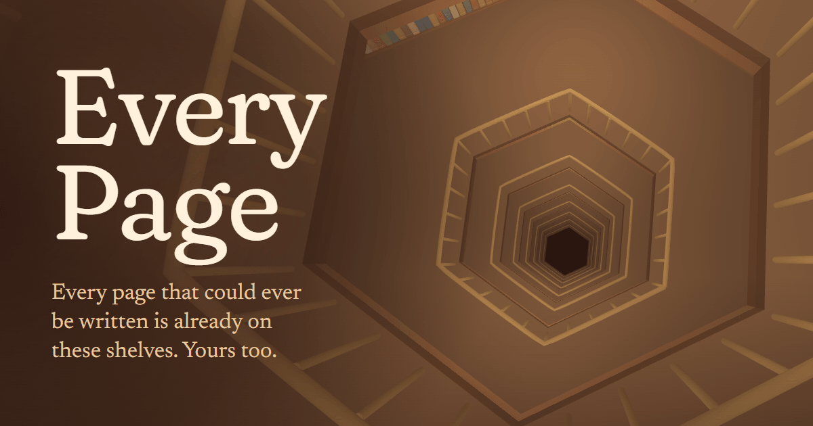

# Every Page



A lamplit, walkable version of Borges's Library of Babel. Every possible page of 3,200 characters is on a shelf somewhere in it, at exactly one place. Type anything, and you fly down the air shaft, follow a trail of light along the gallery to one book, and it opens to the page where your words have always been. You can also ask it for a famous line, which it finds on one of the countless shelves where that line is written, wander the galleries, and share a link to any page or place.

**Visit it:** https://every-page.pages.dev

## Why I built this

Borges's story is a piece of maths in disguise: a finite library that holds everything that could be written. I built Every Page to make a version you could stand inside rather than just search, warm and calm instead of grey and endless, with honest engineering underneath. Each part was a problem I wanted to solve properly:

- **A library that stores nothing.** Each page is a 3,200-digit number in base 29. A six-round Feistel network over those digits shuffles every place in the library into its page, so any page is computed on your device the moment you open it, in BigInt arithmetic in a Web Worker.
- **Search is the shuffle run backwards.** Your words, padded with random characters, become a page, and unshuffling that page gives its shelf. The [How it works](https://every-page.pages.dev/how-it-works/) page explains it with figures you can play with.
- **Endless rooms for the cost of one.** The library is merged, vertex-coloured three.js geometry, and a custom shader dresses every shelf from its room coordinates, so moving through any number of rooms costs nothing. A floating origin handles distances far beyond what floats can hold.
- **Smooth on a phone.** Quality tiers step down on slower devices, and the whole 3D scene is about 154 KB gzipped. Without WebGL2, the site falls back to a reading room that shows the route to the book and opens it.
- **Links that keep your words private.** A shared link puts the words after the `#`, which browsers never send to a server, and opening it walks you to the same page.

## Running it locally

You need Node 22.23 or later.

```sh
npm install
npm run dev       # the site on localhost:4321
npm run build     # type-check and build into dist/
npm run preview   # serve the build
```

## Tech

Astro (static output), TypeScript, three.js with hand-written GLSL, Web Workers, BigInt, Web Audio, and a Cloudflare Worker serving static assets.

## Credits and licences

- My code is MIT licensed (see `LICENSE`).
- The library is Jorge Luis Borges's, from "La biblioteca de Babel" (1941). The quote on the How it works page is from James E. Irby's translation.
- The famous lines all come from public-domain works, credited in the reader where they're found.
- [libraryofbabel.info](https://libraryofbabel.info) by Jonathan Basile, the searchable library this one owes its idea of search to.
- Sounds: footsteps from Kenney's "Impact Sounds" and book sounds from Kenney's "RPG Audio", both CC0 ([kenney.nl](https://kenney.nl)). The room tone and the chime are synthesised in the browser.
- [Fraunces](https://github.com/undercasetype/Fraunces), [Newsreader](https://github.com/productiontype/Newsreader) and [Courier Prime](https://quoteunquoteapps.com/courierprime/), SIL Open Font License 1.1, via Fontsource.
- [three.js](https://threejs.org) and [Astro](https://astro.build), MIT. [TypeScript](https://www.typescriptlang.org), Apache 2.0.
